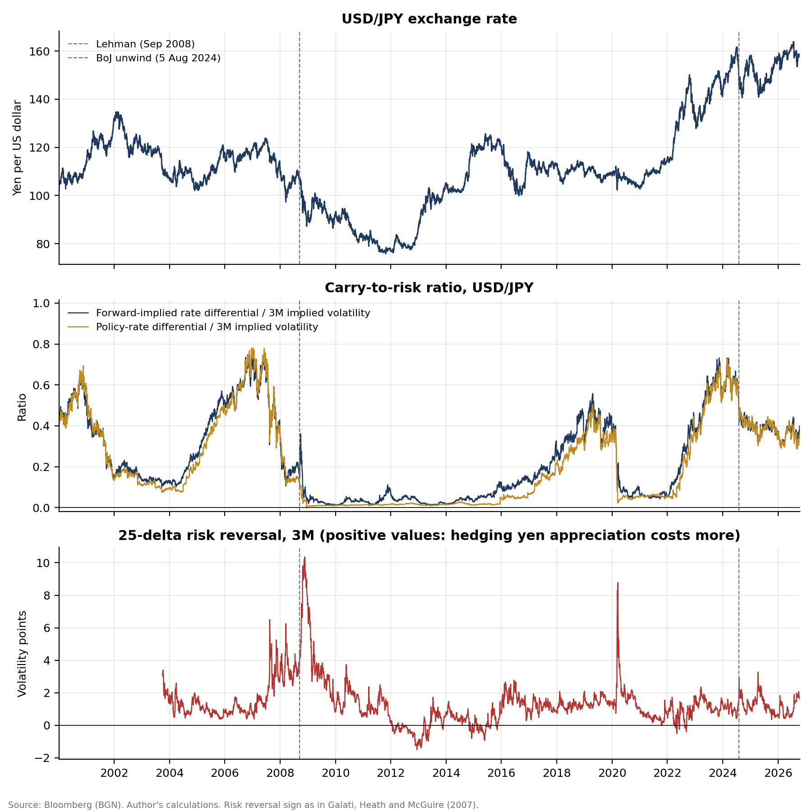
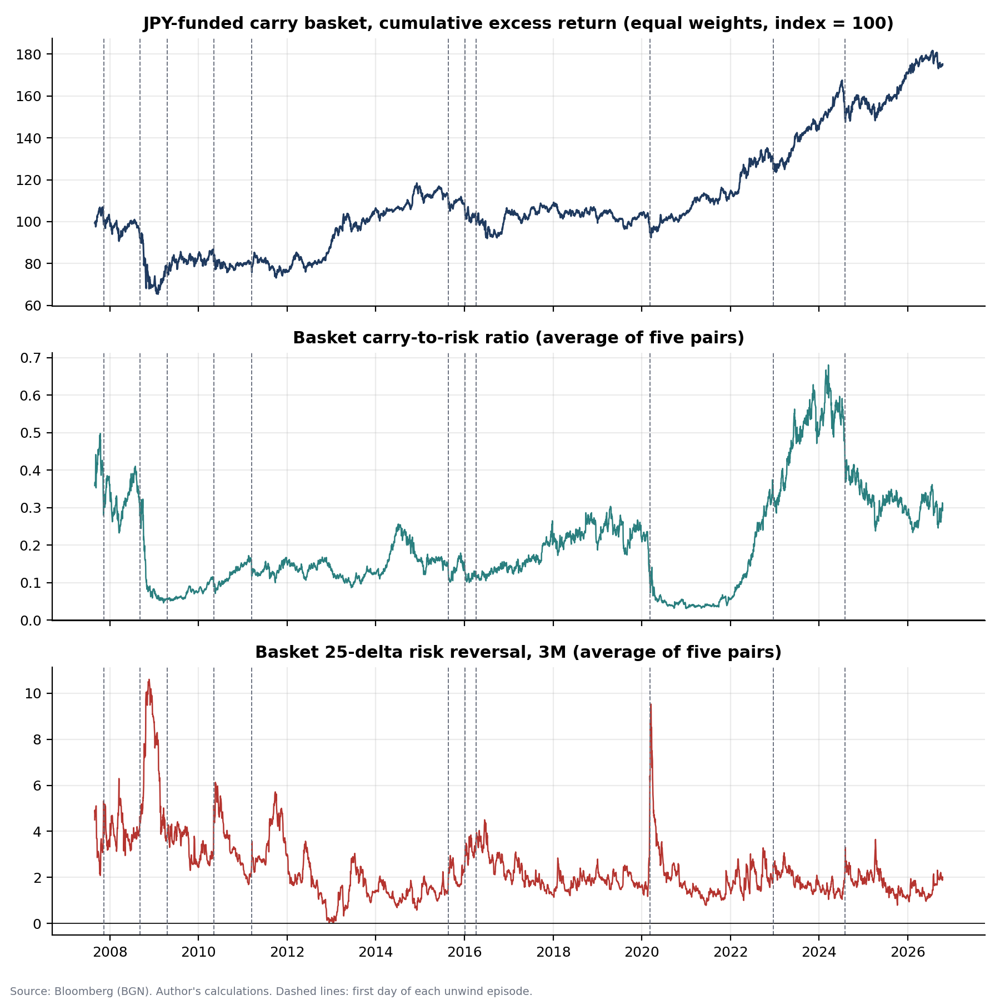
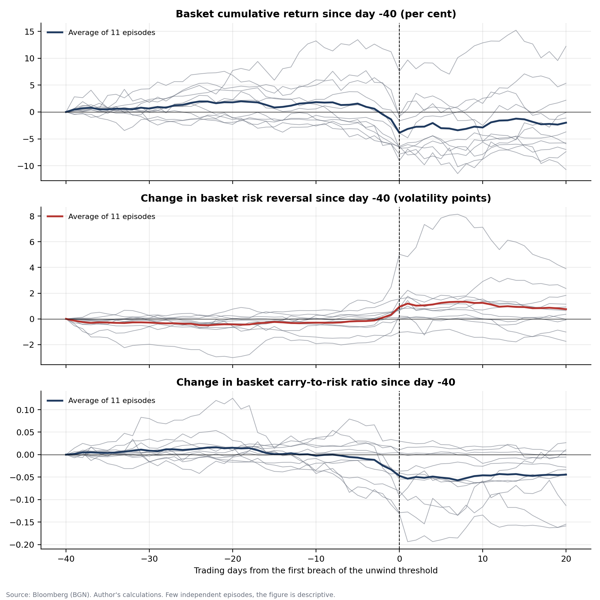
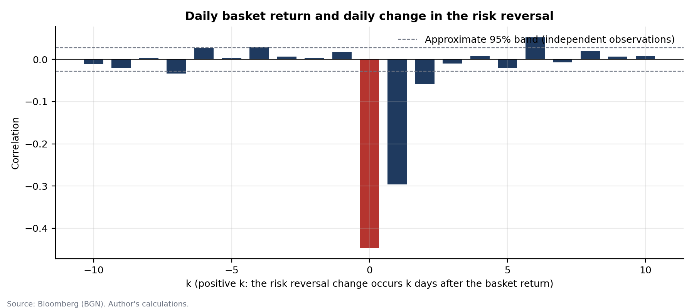

# Do risk reversals warn of yen carry unwinds?

An empirical study of the carry-to-risk ratio and FX risk reversals as signals of unwinds in JPY-funded carry trades, built on Bloomberg data and estimated with the econometric methods of Greene, *Econometric Analysis* (5th edition).

The starting point is Galati, Heath and McGuire (2007), "Evidence of carry trade activity", *BIS Quarterly Review*, September. The authors build a carry-to-risk ratio from three-month interest rate differentials and implied volatilities, and note (citing Gagnon and Chaboud) that risk reversals tend to move after large exchange rate moves. This project rebuilds both indicators daily from 2007 to 2026 and asks whether either one anticipates the large losses of a yen carry basket.

## Findings

The answer is no. The indicators react to unwinds and do not anticipate them.

1. **Returns lead the indicators.** Daily carry returns Granger-cause the changes in the risk reversal and in the carry-to-risk ratio, with Wald p-values below 0.001 at every lag order tested and in both samples. The reverse hypothesis is never rejected for the risk reversal (p between 0.25 and 0.95 across lag orders and samples).
2. **The timing is visible in the correlations.** The daily basket return and the daily change in the risk reversal have a correlation of -0.45 on the same day and -0.30 on the next day, and below 0.035 in absolute value at every lag in which the risk reversal moves first.
3. **No robust predictive power.** In regressions of future basket returns on the 5-day changes of both indicators, one coefficient out of six is significant at 5% (z = 2.09, next-day horizon). None is significant at one-week or one-month horizons with Newey-West errors. On non-overlapping subsamples the median z is between 0.06 and 0.69, and the two monthly grids (out of 21) with |z| above 1.96 for the risk reversal have opposite signs.
4. **Tail weeks.** A probit for the worst 5% of weeks is significant on three of five weekly grids in the main sample and on one of five in the longer sample, with a McFadden index near 0.02. The result depends on the arbitrary starting day of the weekly grid and is treated as not robust.
5. **Risk management still benefits.** Halving exposure when the risk reversal is above its trailing 90th percentile raises the Sharpe ratio of the basket from 0.33 to 0.43 and reduces the maximum drawdown from -32.6% to -24.5%. Because the risk reversal reacts to losses and then stays elevated, the rule cuts exposure during the stress that follows the first shock. It does not anticipate it.

Latest values (16 October 2026): USD/JPY carry-to-risk 0.38 with forward-implied differentials and 0.35 with policy rates; three-month implied volatility 7.9%. Full results are in [`results/RESULTS.md`](results/RESULTS.md).

## Figures









All figures, with the policy-rate chart, the implied versus realised volatility chart, the exposure rule and the probit fit, are in [`results/figures/`](results/figures/).

## Method in brief

| Step | Tool | Greene, 5th ed. |
|---|---|---|
| Interest differentials | Covered interest parity on 3M forward points | |
| Stationarity | Augmented Dickey-Fuller, levels and changes | 20.3.4 |
| Predictive regressions | OLS, Newey-West covariance | 12.5.2, eq. (12-17) |
| Residual checks | Breusch-Godfrey LM, Ljung-Box Q, ARCH LM | 12.7.1, 12.7.2, 11.8.4 |
| Direction of causality | Granger tests, Wald with robust covariance | 19.6.5 |
| Tail weeks | Probit, LR and Wald tests, marginal effects | 21.4 |

Every step, every choice and the checks behind it are documented in [`METHODOLOGY.md`](METHODOLOGY.md).

## Data

Daily Bloomberg history (field PX_LAST, BGN pricing) for five JPY crosses (USD, AUD, NZD, GBP and CAD against the yen): spot, three-month at-the-money implied volatility, 25-delta three-month risk reversal and three-month forward points, plus the VIX and the policy rates of the Federal Reserve and the Bank of Japan. The ticker list is in [`data/tickers.csv`](data/tickers.csv).

**Raw data are not included.** Bloomberg data cannot be redistributed. To reproduce the study, export the listed series from a Bloomberg terminal into one folder (one `.xlsx` per series, as produced by the history export) and point the script to it.

## How to run

```bash
pip install -r requirements.txt
python run_analysis.py --data-dir "path/to/bloomberg exports"
python -m pytest -q
```

The first command writes tables, figures and `RESULTS.md` to `results/`. The tests check that the code reproduces the formulas in Greene: the Newey-West covariance against equation (12-17) computed by hand, the Breusch-Godfrey, Ljung-Box and ARCH statistics against their textbook definitions, the covered interest parity signs, the absence of look-ahead in the exposure rule, and the probit fit measures.

## Repository structure

```
run_analysis.py              full pipeline
src/carry_unwind/
    config.py                every parameter of the study, fixed before estimation
    io.py                    reading Bloomberg exports
    variables.py             differentials, carry-to-risk, risk reversals, returns, baskets
    econometrics.py          estimators and tests
    figures.py               charts
tests/test_econometrics.py   checks against the textbook formulas
data/tickers.csv             series to download
results/                     tables (csv), RESULTS.md, figures
```

## Limitations

The number of independent unwind episodes is small (eleven in the main sample), so the event study is descriptive. Forward-implied differentials include the cross-currency basis. The main sample starts in August 2007 because the Bloomberg option history of NZD/JPY and CAD/JPY has gaps of several months before that date; a two-pair basket (USD/JPY and AUD/JPY) from October 2004 is used as a robustness check and confirms the conclusions. Many tests are run, so isolated p-values below 5% should be read with that in mind.

## References

Galati, G., A. Heath and P. McGuire (2007), "Evidence of carry trade activity", *BIS Quarterly Review*, September, pp. 27-41.

Greene, W. H. (2003), *Econometric Analysis*, 5th edition, Prentice Hall.

## Author

Alessandro Mazzarini. Code released under the MIT licence (see `LICENSE`). The licence covers the code only. Bloomberg data are not included, and the figures and tables, which are the author's elaborations of Bloomberg data, carry the source line "Bloomberg (BGN)".
